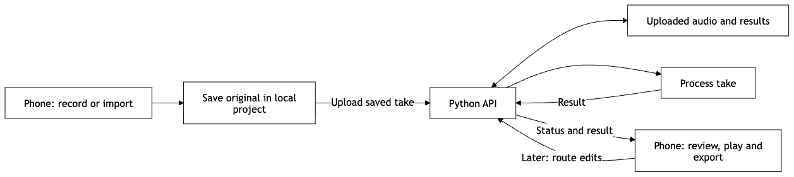

# System architecture

**Draft for Nil and Arhan to review.** Covers T1.3 ([#7](https://github.com/nyenilmez23/intelligent_music_recorder/issues/7)) and D1.1 ([#11](https://github.com/nyenilmez23/intelligent_music_recorder/issues/11)). The component boundaries follow the COMP491 proposal, Figure 3 (p. 17). The [API draft](api.md) makes the first integration concrete.

## Platform decision

**Initial platform: iOS.** The primary user is an amateur musician recording on an iPhone. Build and verify the first app on iOS, including the PM2 demo on a physical iPhone. Android remains part of the proposal's broader cross-platform scope and is outside the initial release.

**Framework to confirm:** React Native and Flutter remain options for the iOS app, with a Python backend in either case. If Arhan or Emir already has a working iOS shell or recorder, use that as the starting point. Confirm that it can save and replay a recording on the demo iPhone before settling the framework and capture format.

| Component | Owns | Handoff |
| --- | --- | --- |
| Mobile app (`mobile/`) | Projects and takes, recording or import, local originals, playback, Metro Map review and editing, export | Sends an audio file with stable project and take IDs. Shows the result or a recoverable error. |
| Python backend (`backend/`) | API, uploaded audio and result storage, processing job management as the pipeline grows | Accepts a saved take and returns the result for its IDs. The PM2 processor is a placeholder. |
| Audio processing (`backend/processing/`) | Preprocessing, repeat detection, alignment and segmentation, reference-free scoring, composite selection, stitching and rendering | Runs on test files independently of the mobile app. The backend calls the processing module and returns its results to the app. |

These are proposed locations. Create each directory when it has its first implementation.

*System Architecture and Data Flow*

[Editable diagram source](architecture-flow.mmd)

The proposal supports separate takes and continuous recordings containing repeated passages. Analysis uses the musician's own recordings, without sheet music, a song database, or an external reference recording. The final single-instrument evaluation covers recordings up to five minutes and up to five attempts (proposal §2.3, pp. 23–24). The suggested composite remains editable by the musician.

## PM2 and the next handoffs

| Scope | Evidence |
| --- | --- |
| T6.1 / D6.1 ([#10](https://github.com/nyenilmez23/intelligent_music_recorder/issues/10), [#14](https://github.com/nyenilmez23/intelligent_music_recorder/issues/14)) | Record a short take on a physical iPhone, save it locally, upload it, and show the backend's placeholder result. A sample file is enough to test the connection while recording is being built. |
| M2.1 ([#17](https://github.com/nyenilmez23/intelligent_music_recorder/issues/17)) | Show the interactive prototype with prepared takes. This can be demonstrated separately from the backend round trip. |
| M6.1 ([#18](https://github.com/nyenilmez23/intelligent_music_recorder/issues/18)) | Demonstrate the first integrated build at PM2 and identify the processing step as a placeholder. |
| T2.5 / T6.3 (proposal pp. 11 and 15) | Extend upload and sync after the skeleton. Add asynchronous jobs and progress reporting for longer recordings in T6.3. |

Nil and Arhan agree on the repo layout, the iOS app framework, and one request/response example. Emir confirms the recording format on the demo iPhone. Nil can then test the API using a fixture while Arhan wires the app to the same contract. Demir and Çakıl can develop and test the processing modules on annotated recordings without waiting for the backend integration.

Use a consented or synthetic recording for the demo. Save the original on the phone before upload and retain it if processing fails. Show where the recording goes before transferring it to the backend. Use a trusted development network for the demo; a deployed service needs authenticated access before accepting personal recordings.
